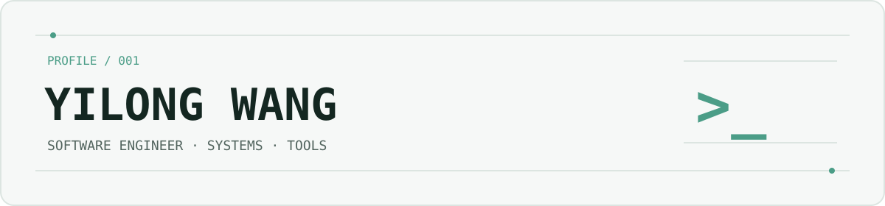

<picture>
  <source media="(prefers-color-scheme: dark)" srcset="./assets/banner-dark.svg">
  <source media="(prefers-color-scheme: light)" srcset="./assets/banner-light.svg">
  
</picture>

### Hello, I'm Yilong.

Software engineer at **Huawei** · M.Eng, **National University of Singapore** · Based in **Shanghai**

I work across AI systems, backend engineering, and DevOps. Outside work, I build small, thoughtful macOS tools for photography and everyday workflows.

### Selected work

| Project | What it does |
| :--- | :--- |
| **[Focal Length](https://github.com/LittleWang6770/focal-length)** | A native, read-only Mac app for exploring focal lengths and lenses across local folders and Apple Photos. |
| **[Batch GPS Copy](https://github.com/LittleWang6770/batch-gps-copy)** | A macOS app and CLI for copying location metadata across photo collections, with clear overwrite and backup choices. |
| **[Snapshot Ledger](https://github.com/LittleWang6770/snapshot-ledger)** | A local SwiftUI app for tracking account snapshots and understanding how balances change over time. |

Interested in useful software, reliable systems, and the little details that make tools feel right.
